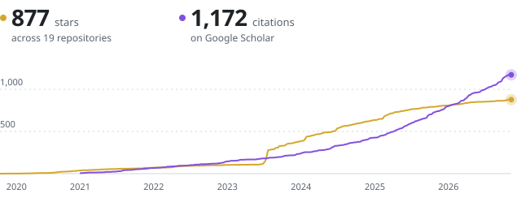

### Hi, I'm Zhao (Dylan) Wang

Head of Foundation Model at [LimX Dynamics](https://www.limxdynamics.com/en), building System 0 and System 1 for humanoid robots. 
Embodied AI · whole-body intelligence · interactive embodied models · multimodal motion synthesis

[Homepage](https://kyfafyd.wang) &nbsp;·&nbsp; [Google Scholar](https://scholar.google.com/citations?user=1kEufdwAAAAJ) &nbsp;·&nbsp; [LinkedIn](https://www.linkedin.com/in/kyfafyd) &nbsp;·&nbsp; [X](https://x.com/kyfafyd)

 

<a href="https://github.com/Kyfafyd/kyfafyd/blob/main/profile/stars.md">
  <picture>
    <source media="(prefers-color-scheme: dark)" srcset="profile/dashboard-dark.svg">
    
  </picture>
</a>

We're hiring full-time researchers and engineers (all levels) and interns in embodied AI at LimX Dynamics. Send your CV to dylan@limxdynamics.com.

